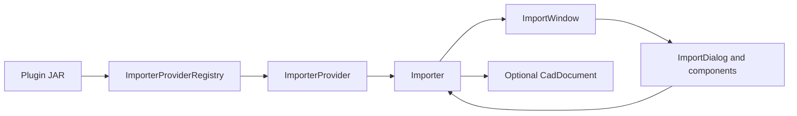

# VoxelBrew Import API

The Import API lets you add a document importer to VoxelBrew without building it
into the application. A plugin can read a local file or another source and return
an editable `CadDocument`. The desktop application and CLI discover providers
from JARs and collect their settings through the same frontend-neutral contract.

This repository contains the public API, licensed under [MIT](LICENSE). You can
develop and distribute an importer separately, including as a private plugin.
The VoxelBrew application is [separately licensed under AGPL-3.0](https://github.com/Voxel-Brew/VoxelBrew/blob/master/LICENSE);
that license does not apply to this API repository.

## How it works

An `ImporterProvider` gives the host an `ImporterDescriptor` with a stable ID,
display name, and implementation version. It creates an `Importer`, which asks
an `ImportWindow` to show an `ImportDialog<T>`. The importer reads the accepted
source and returns `Optional<CadDocument>` containing a detached document.
Cancelling the dialog returns `Optional.empty()` before any read. Validation or
conversion failures may be thrown as checked exceptions.

The host runs desktop imports on a file worker and shows dialogs on the UI thread.
The CLI resolves the same dialog inputs from command-line arguments. Dialogs use
`VerticalLayout`, `HorizontalLayout`, and components such as `TextField` and
`FileSource`. The importer owns source access, bounded reading, and document
validation. `FileImportDialog` provides a standard local-file picker; custom
settings use the same component-based dialog contract.

## Start developing

Use Java 21 and depend on `dev.voxelbrew.api:import`. Register your provider
class in `META-INF/services/dev.voxelbrew.api.importer.ImporterProvider`, then
package that resource with your implementation JAR. Keep VoxelBrew API classes
out of the JAR; the host supplies them at runtime.

See the [developer guide](doc/DEV_README.md) for a complete plate-file importer,
custom dialog, bounded read, CLI usage, packaging, verification, and migration
instructions for plugins built against the old Import API.

## License

The Import API is licensed under the [MIT License](LICENSE).
