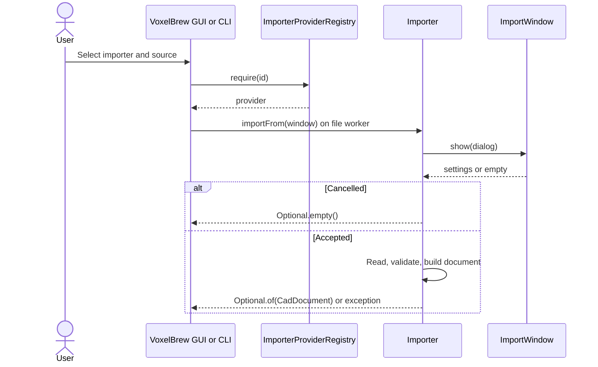

# Develop a VoxelBrew importer

This guide builds a small `PlateImporter` plugin. It reads a UTF-8 file containing
`width,height,thickness` in millimeters, such as `60,40,4`, and returns an editable
rectangle sketch and extrusion. A custom dialog adds an optional scale setting.
The same API can read other local formats or fetch a document from a service.

The public types are in `dev.voxelbrew.api.importer` and
`dev.voxelbrew.api.importer.component`. They do not depend on JavaFX, the CLI, or
VoxelBrew's native geometry engine. Java excerpts below omit imports and package
declarations for clarity.



## 1. Add the API dependency

Use Java 21. For a released version from Maven Central, a minimal Gradle project
looks like this:

```kotlin
plugins { `java-library` }

repositories { mavenCentral() }

dependencies {
    compileOnly("dev.voxelbrew.api:import:<version>")
}
```

Replace `<version>` with a [published version](https://central.sonatype.com/artifact/dev.voxelbrew.api/import).
`compileOnly` keeps host API classes out of your plugin JAR. The Import API exposes
`CadDocument` and `Feature` through its Model API dependency. For snapshots, use
the matching VoxelBrew BOM and the GitHub Packages repositories configured in
[`gradle/repositories.gradle.kts`](../gradle/repositories.gradle.kts).

## 2. Describe the importer

Implement `ImporterProvider`. The descriptor ID is the stable programmatic name
used by the CLI. It must match `[a-z0-9][a-z0-9.-]*` and be distinct from other
importers. Use your plugin's implementation version, not an API version.

```java
public final class PlateImporterProvider implements ImporterProvider {
    public PlateImporterProvider() {}

    @Override
    public ImporterDescriptor descriptor() {
        return new ImporterDescriptor("plate", "Plate file", "1.0.0");
    }

    @Override
    public Importer create() {
        return new PlateImporter();
    }
}
```

`ServiceLoader` requires a public no-argument constructor. Keep `descriptor()`
and `create()` lightweight. The host chooses a worker for desktop imports;
`create()` does not receive or own an executor. The descriptor identifies the
provider, while its dialog defines file filters and settings.

## 3. Define settings and the dialog

The example keeps accepted settings in an immutable record. A `FileSource` input
selects the source file; a `TextField` supplies the scale.

```java
public record PlateSettings(Path source, double scale) {}
```

Implement all four `ImportDialog<T>` methods. `layout()` builds a component tree;
only inputs have IDs. `validate()` returns all errors keyed by those IDs, and
`buildSettings()` converts valid strings into typed settings. Revalidate inside
`buildSettings()` because a caller can invoke it directly.

```java
public final class PlateImportDialog implements ImportDialog<PlateSettings> {
    private final FileSource sourceInput = new FileSource("source", "plate");
    private final TextField scaleInput = new TextField("scale", "Scale", "1");

    @Override
    public String title() {
        return "Import plate";
    }

    @Override
    public ImportDialogLayout layout() {
        return new VerticalLayout(sourceInput, scaleInput);
    }

    @Override
    public Map<String, String> validate(Map<String, String> values) {
        var errors = new LinkedHashMap<String, String>();
        String source = values.get(sourceInput.id());
        if (source == null || source.isBlank()) {
            errors.put(sourceInput.id(), "Choose a source file");
        } else {
            try {
                Path path = Path.of(source);
                if (!Files.isRegularFile(path) || !Files.isReadable(path))
                    errors.put(sourceInput.id(), "Choose a readable file");
            } catch (InvalidPathException failure) {
                errors.put(sourceInput.id(), "Invalid source path");
            }
        }

        String scale = values.getOrDefault(scaleInput.id(), scaleInput.value());
        try {
            double number = Double.parseDouble(scale);
            if (!Double.isFinite(number) || number <= 0)
                errors.put(scaleInput.id(), "Use a positive scale");
        } catch (NumberFormatException failure) {
            errors.put(scaleInput.id(), "Use a number");
        }
        return errors;
    }

    @Override
    public PlateSettings buildSettings(Map<String, String> values) {
        var errors = validate(values);
        if (!errors.isEmpty()) throw new IllegalArgumentException(errors.toString());
        return new PlateSettings(
                Path.of(values.get(sourceInput.id())),
                Double.parseDouble(values.getOrDefault(scaleInput.id(), scaleInput.value())));
    }
}
```

The host may call `validate()` repeatedly as values change, so keep it free of
side effects. Treat missing values as missing or apply the same defaults in both
methods. Use unique input IDs. `VerticalLayout` and `HorizontalLayout` can nest;
other controls include `TextArea`, `CheckBox`, `ComboBox`, `RadioButtonGroup`,
and `Slider`. `Label` and `Separator` are display-only. `FileSource` accepts an
optional third `Path defaultPath`; without it, the host chooses an initial path
or prompts for one.

For an import needing only a local source, use the built-in
`new FileImportDialog("Import plate", "plate")` instead. Its `sourceInput()` is a
`FileSource`, and accepted settings are `FileImportDialog.Source(Path)`. It
validates missing, malformed, nonexistent, non-file, and unreadable paths. The
extension configures the Open chooser filter; it does not require a matching
filename suffix. The accepted `Path` is preserved as supplied.

In the desktop, invalid input keeps the dialog open and shows errors beside the
affected controls until corrected. The CLI reports unknown or invalid option
IDs. The importer must still validate the file when reading because the file
system can change after the dialog closes.

## 4. Read and return the document

Call `window.show(dialog)` from `importFrom()`. An empty result means the user
cancelled; return `Optional.empty()` before opening the source. On acceptance,
read on the host's calling thread and return a detached `CadDocument` only after
validation and resource cleanup. Checked failures propagate to the host.

```java
public final class PlateImporter implements Importer {
    private static final int MAX_BYTES = 4096;

    @Override
    public Optional<CadDocument> importFrom(ImportWindow window) throws IOException {
        var accepted = window.show(new PlateImportDialog());
        if (accepted.isEmpty()) return Optional.empty();
        return Optional.of(read(accepted.orElseThrow()));
    }

    private static CadDocument read(PlateSettings settings) throws IOException {
        byte[] bytes;
        try (var input = Files.newInputStream(settings.source())) {
            bytes = input.readNBytes(MAX_BYTES + 1);
        }
        if (bytes.length > MAX_BYTES) throw new IOException("Plate file exceeds 4 KiB");

        String text = StandardCharsets.UTF_8.newDecoder()
                .decode(ByteBuffer.wrap(bytes)).toString();
        String[] fields = text.strip().split(",", -1);
        if (fields.length != 3) throw new IOException("Expected width,height,thickness");
        double width = positive(fields[0]) * settings.scale();
        double height = positive(fields[1]) * settings.scale();
        double thickness = positive(fields[2]) * settings.scale();
        if (!Double.isFinite(width) || !Double.isFinite(height) || !Double.isFinite(thickness))
            throw new IOException("Scaled dimensions must be finite");

        var sketch = new Feature.Sketch(
                "plate", "profile", new Feature.Plane("origin-xy", 0),
                new Feature.Rectangle(0, 0, width, height));
        var extrude = new Feature.Extrude(
                "thickness", new Feature.ProfileRef("plate", "profile"), thickness);
        return new CadDocument("imported-plate", List.of(sketch, extrude), 2);
    }

    private static double positive(String text) throws IOException {
        try {
            double number = Double.parseDouble(text.strip());
            if (Double.isFinite(number) && number > 0) return number;
        } catch (NumberFormatException ignored) {
            // Report malformed and out-of-range values consistently.
        }
        throw new IOException("Dimensions must be positive finite numbers");
    }
}
```

The bounded read also rejects files that grow after opening. The UTF-8 decoder
rejects malformed input. A production importer should validate all format
limits, units, references, and editable feature semantics before returning a
document. Never modify the source. Do not log final success or cancellation
from the plugin; the GUI and CLI handle those results.

## 5. Register and package the provider

Create this UTF-8 resource in your plugin project:

```text
src/main/resources/META-INF/services/dev.voxelbrew.api.importer.ImporterProvider
```

Put the fully qualified provider class name on its own line:

```text
com.example.voxelbrew.PlateImporterProvider
```

Build a JAR containing the provider, importer, dialog, settings, and service
resource. Install it in `~/.voxelbrew/plugins`, or select another directory with
`--plugin-dir`. Do not bundle VoxelBrew API classes. The registry discovers
providers, logs broken ones, and keeps the first provider for a duplicate ID.
The host keeps the registry and plugin class loaders alive until active imports
finish.

## 6. Try it in the CLI

With the installed CLI launcher (`cli.bat` on Windows), list providers and import
a file whose path and plugin directory both contain spaces:

```text
cli document importers --plugin-dir "path with spaces/plugins"
cli document import "plate dimensions.plate" --format plate \
  --option scale=2 --output "imported design.vxb" \
  --plugin-dir "path with spaces/plugins"
```

The source argument fills the `FileSource` input. `--option scale=2` fills the
custom component with ID `scale`; omit it to use the dialog's default of `1`.
The CLI rejects unknown IDs and invalid values. An output path is required for
document imports, must differ from the source, and needs `--overwrite` to replace
an existing file. An empty import result writes nothing. The desktop opens a
successful import as an unsaved design; cancellation or failure leaves the
current document intact.

## 7. Verify your plugin

- Compile against the API and inspect the JAR for the exact provider service
  resource. Test discovery from a separate plugin directory.
- Test missing and invalid settings together. Every validation key should match
  an input ID, and direct `buildSettings()` calls must reject invalid values.
- Test cancellation before opening the source and a successful editable
  `CadDocument` with an independent evaluator where practical.
- Test checked failures, malformed UTF-8, oversized input, and unchanged source
  bytes. Keep existing application documents and CLI output intact on failure.
- Test source paths and plugin directories containing spaces, unknown CLI
  options, source/output collisions, and duplicate provider IDs.

Run `./gradlew check` from this API repository (`.\gradlew.bat check` on Windows).
The [independent provider fixture](https://github.com/Voxel-Brew/VoxelBrew/tree/master/fixtures/exporter-plugin)
in the application repository verifies API-only compilation and host discovery.

## Breaking migration from the old Import API

Recompile every importer plugin. Move imports from `dev.voxelbrew.importer.api`
to `dev.voxelbrew.api.importer` and register the new `ImporterProvider` service
name. Replace `create(Executor)`, futures, `ImportResult`, API-version and
result-kind metadata with parameterless `create()`, synchronous
`Optional<CadDocument>`, and your implementation version. Replace mutable
dialog state and `ImportOption` definitions with component layouts,
`validate(values)`, and `buildSettings(values)`. The host owns worker and UI
dispatch. Direct document and G-code reader ports now live in the application
importer module. There are no compatibility adapters.
